# ОТЧЁТ по лабораторным работам №1–8

по дисциплине «Проектирование веб-сайтов»

**Выполнил:** Суббота Василий Владимирович

**Группа:** ОВБИ-304б

**Проверил:** ______________________

**Год:** 2026

---

## Общая информация

Все лабораторные работы выполнены на JavaScript / Node.js и проверены запуском. Средства выполнения: **Node.js v22.22.2**, редактор VS Code. Каждая работа оформлена отдельным файлом (`laba1.js` … `laba8.js`), в конце файла приведены письменные ответы на контрольные вопросы.

| № | Работа | Файл | Как запустить |
|---|---|---|---|
| 1 | Синтаксис JS: циклы, массивы, функции | `laba1.js` | `node laba1.js` |
| 2 | Работа с Git и командная разработка | `laba2.js` + папка `laba2/` | `node laba2.js` |
| 3 | Функции: Declaration, Expression, стрелочные, замыкания | `laba3.js` | `node laba3.js` |
| 4 | Чистые функции, рекурсия, map/filter/reduce | `laba4.js` | `node laba4.js` |
| 5 | Объекты, прототипы, наследование | `laba5.js` | `node laba5.js` |
| 6 | Классы, ошибки, короткое вычисление | `laba6.js` | `node laba6.js` |
| 7 | EventEmitter и потоки Node.js | `laba7.js` | `node laba7.js` |
| 8 | React, AJAX, Comet, WebSocket | `laba8.js` + папка `laba8/` | `node laba8.js` (порт 3000) |

Скриншоты консольного вывода всех работ приведены ниже по каждой лабораторной работе. Полный код — в соответствующих файлах `.js`, здесь показаны ключевые фрагменты.

---

## Лабораторная работа №1. Введение в синтаксис JavaScript: циклы, массивы, функции

### Задание

- Задание 1. Функция rangeJS(start, end) — массив чисел от start до end (не включая end).
- Задание 2. Массив numbers = [2, 5, 8, 12, 3]: новый массив squares (квадраты) и сумма всех элементов через while.
- Задание 3. Функция drawPyramid(height) — пирамидка из символов «#».
- Задание 4. Функция getExperienced(studentsList, minExp) — имена студентов с опытом не меньше minExp.

### Ключевой код решения

```js
// Задание 1: аналог range()
function rangeJS(start, end) {
    const result = [];
    for (let i = start; i < end; i++) {
        result.push(i);          // аналог Python append()
    }
    return result;
}

// Задание 2: квадраты и сумма
const numbers = [2, 5, 8, 12, 3];
const squares = [];
for (const value of numbers) squares.push(value ** 2);

let sum = 0, i = 0;
while (i < numbers.length) { sum += numbers[i]; i++; }

// Задание 3: пирамидка
function drawPyramid(height) {
    for (let row = 1; row <= height; row++) {
        console.log('#'.repeat(row));
    }
}

// Задание 4: фильтрация
function getExperienced(studentsList, minExp) {
    const names = [];
    for (const student of studentsList) {
        if (student.exp >= minExp) names.push(student.name);
    }
    return names;
}
```

### Результат выполнения

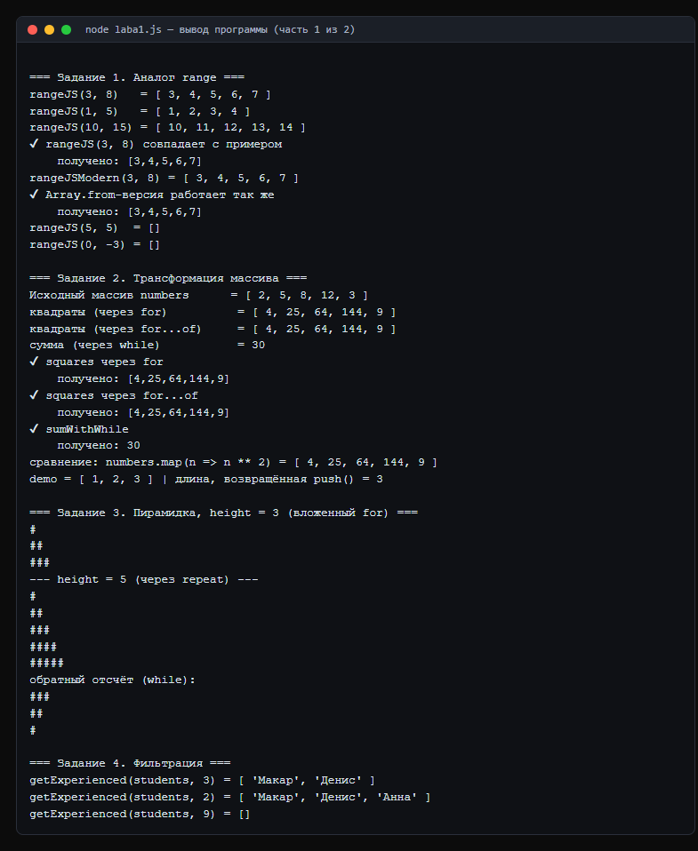

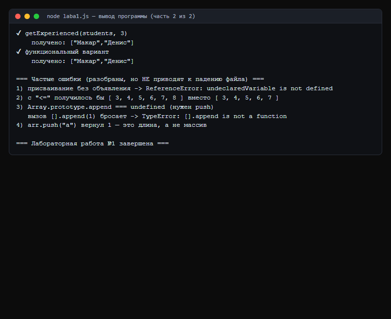

### Ответы на контрольные вопросы

**Вопрос 1. Чем отличается объявление переменной через let от const?**

let создаёт переменную, значение которой можно переприсваивать, const — константную привязку, переприсваивание запрещено (TypeError). Важный нюанс: const защищает не объект, а привязку — содержимое массива или объекта менять можно (arr.push(3) работает), а вот присвоить arr = [9] нельзя. Обе имеют блочную область видимости; старый var «всплывает» наверх функции и виден за пределами блока.

**Вопрос 2. Почему в JS нельзя написать for i in range(5) как в Python? Чем это чревато?**

В JavaScript нет встроенной функции range(), а ключевое слово in означает совсем другое — проверку наличия свойства и перебор ключей: for (x in obj) перебирает ИМЕНА свойств (для массива это строки "0", "1", …), а также унаследованные свойства из прототипа. Выражение i in range(5) вызовет ReferenceError, если range не объявлена. Правильные аналоги: for (let i = 0; i < 5; i++) или for...of по массиву.

**Вопрос 3. Какой метод массива заменяет Python-метод append?**

push(). Он добавляет элементы в конец массива и возвращает НОВУЮ ДЛИНУ массива (а не сам массив — это частая ошибка). Соответствия: append → push, insert(0, x) → unshift, pop() → pop, pop(0) → shift, x in list → includes.

---

## Лабораторная работа №2. Работа с Git, репозиторием и командная разработка (программа «Анализ успеваемости»)

### Задание

- Этап 1. Настроить репозиторий: клонировать общий, создать ветки main и develop, каждому участнику — свою ветку feature/имя.
- Этап 2. Написать функции: calculateAverage (средний балл), findTopStudent (лучший студент), filterFailed (должники), addLetterGrade (буквенные оценки A/B/C).
- Этап 3. Зафиксировать работу в Git: коммиты в личные ветки, Pull Request в develop, ревью тимлида, слияние; затем PR develop → main.

### Ключевой код решения

```js
// laba2/modules/average.js — средний балл
function calculateAverage(data) {
    if (!Array.isArray(data) || data.length === 0) return 0;
    const total = data.reduce((acc, student) => acc + student.score, 0);
    return Math.round((total / data.length) * 100) / 100;
}

// laba2/modules/top.js — лучший студент
function findTopStudent(data) {
    let best = data[0];
    for (const student of data) {
        if (student.score > best.score) best = student;   // при равенстве остаётся первый
    }
    return best.name;
}

// laba2/modules/failed.js — должники
function filterFailed(data, passScore) {
    return data.filter(s => s.score < passScore).map(s => s.name);
}

// laba2/modules/letter.js — буквенные оценки
function addLetterGrade(data) {
    return data.map(s => ({ ...s, letter: s.score >= 90 ? 'A' : s.score >= 75 ? 'B' : 'C' }));
}
```

### Результат выполнения

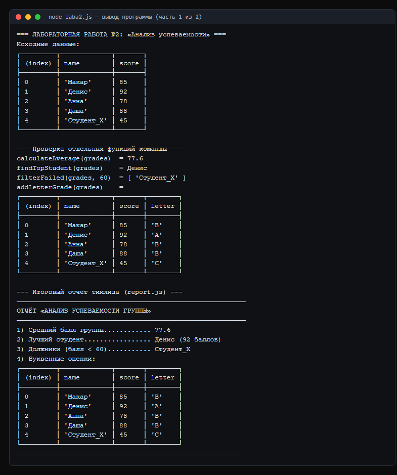

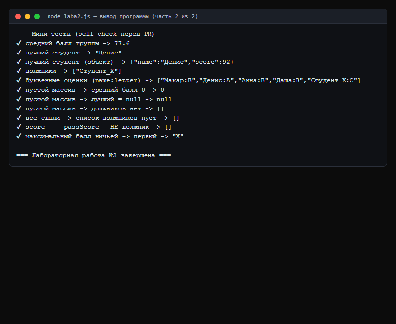

### Ответы на контрольные вопросы

**Вопрос 1. Как выполнялась командная часть в Git (по этапам)?**

Тимлид создал ветки main (стабильная) и develop (разработка). Каждый участник создал личную ветку feature/<имя> от develop и работал только в своём файле-модуле: git add <файл> → git commit -m "feat(модуль): описание" → git push -u origin feature/<имя>. Далее участник открывал Pull Request в ветку develop с ревьюером-тимлидом; после проверки тимлид вливал изменения командой git merge --no-ff, чтобы в истории остался отдельный коммит слияния. Финально тимлид сделал PR develop → main и продемонстрировал итоговый скрипт.

**Вопрос 2. Что даёт флаг --no-ff при слиянии и как разрешать конфликты?**

Флаг --no-ff запрещает fast-forward, поэтому создаётся отдельный коммит слияния — в истории git log --graph видно, что изменения пришли именно из PR. Конфликт возникает, когда две ветки меняют одну и ту же строку: git сообщает CONFLICT (content), в файле появляются маркеры <<<<<<< HEAD, =======, >>>>>>>; нужно оставить нужный вариант, удалить маркеры, затем git add <файл> и git commit.

**Вопрос 3. Итоговые результаты программы.**

Средний балл группы — 77.6; лучший студент — Денис (92 балла); должники — Студент_X (45 баллов, ниже проходного 60); буквенные оценки: Денис — A, Макар/Анна/Даша — B, Студент_X — C. Все результаты выводятся через console.log и таблицей через console.table, а также проверяются мини-тестами прямо в файле laba2.js.

---

## Лабораторная работа №3. Объявление функций, параметры, return, Function Expression, стрелочные функции

### Задание

- Задача 1. calculateDiscountedPrice(price, discount = 0) — цена со скидкой (1000, 10 → 900; 500 → 500).
- Задача 2. isEven — проверка чётности через Function Expression.
- Задача 3. formatName — формирование строки «Фамилия, Имя» через стрелочную функцию и значения по умолчанию.
- Задача 4. mathOperation(a, b, callback) + add/subtract/multiply — передача функции как аргумента.
- Задача 5. createGreeting(phrase) — генератор приветствий (замыкание).

### Ключевой код решения

```js
// Задача 1: значение параметра по умолчанию
function calculateDiscountedPrice(price, discount = 0) {
    const finalPrice = price - (price * discount) / 100;
    return Math.round(finalPrice * 100) / 100;
}

// Задача 2: Function Expression
const isEven = function (number) {
    return number % 2 === 0;
};

// Задача 3: стрелочная функция
const formatName = (firstName = '', lastName = '') => {
    const first = String(firstName).trim();
    const last = String(lastName).trim();
    if (first && last) return `${last}, ${first}`;
    if (last) return `Уважаемый(ая) ${last}`;
    return 'Аноним';
};

// Задача 4: функция высшего порядка
function mathOperation(a, b, operation) {
    return operation(a, b);
}
mathOperation(10, 5, add);       // 15

// Задача 5: замыкание
function createGreeting(greeting) {
    return function (name) {       // помнит greeting после выхода из createGreeting
        return `${greeting}, ${name}!`;
    };
}
const sayHi = createGreeting('Привет');
sayHi('Анна');                    // "Привет, Анна!"
```

### Результат выполнения

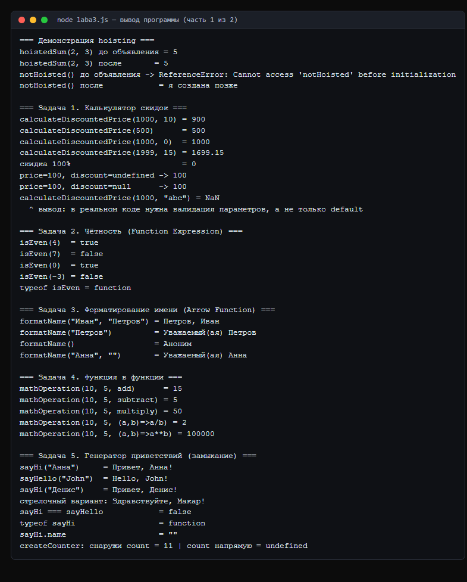

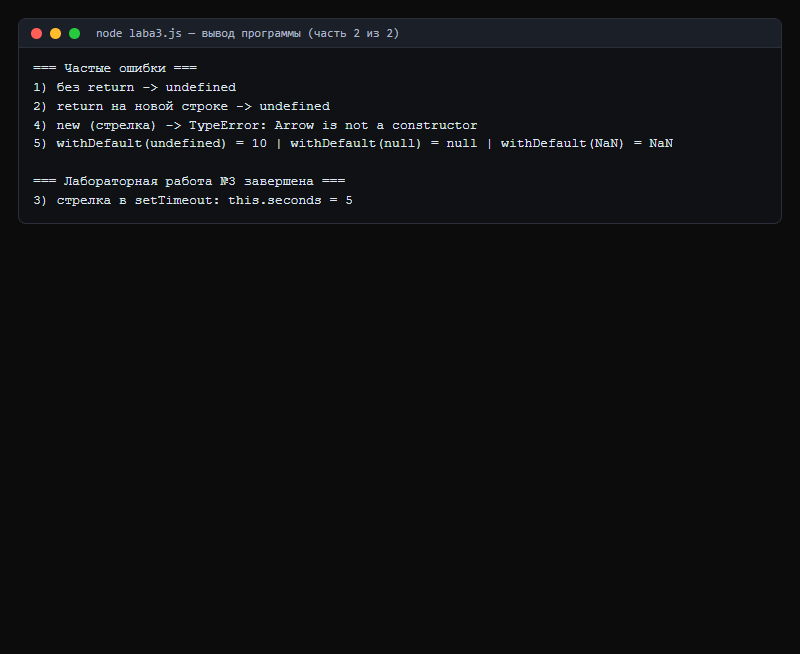

### Ответы на контрольные вопросы

**Вопрос 1. В чём разница между Function Declaration и Function Expression?**

Function Declaration — это отдельный оператор (function sum(a, b) {…}), она «всплывает»: движок создаёт её до выполнения кода, поэтому вызов до объявления работает. Function Expression — это функция как значение (const sum = function (a, b) {…}), она создаётся в момент выполнения строки, и вызвать её раньше нельзя (для const — ReferenceError из-за временной мёртвой зоны). У Expression может не быть имени; имя, если задано, доступно только внутри самой функции.

**Вопрос 2. Что такое стрелочная функция? Когда удобно её использовать?**

Это компактный синтаксис: (a, b) => a / b. У стрелки нет собственного this (берётся из внешнего окружения), нет объекта arguments, она не может быть конструктором (new выдаст TypeError) и не может быть генератором. Удобна в колбэках: arr.map(x => x * 2), в обработчиках внутри методов класса — не нужно писать const self = this. Не подходит для методов объекта, которым нужен собственный this.

**Вопрос 3. Что произойдёт, если функция не содержит return?**

Ошибки не будет — функция вернёт undefined. return без значения тоже возвращает undefined, но завершает функцию досрочно. Ловушка ASI: если return и значение стоят на разных строках, вернётся undefined (return {ok:true} — вернёт undefined). Для конструктора отсутствие return означает возврат this; для async-функции — Promise, разрешающийся в undefined.

**Вопрос 4. Что такое «замыкание» (closure) на примере задачи 5?**

Замыкание — это функция вместе со своим лексическим окружением: все внешние переменные, к которым она обращается, сохраняются в памяти столько, сколько живёт функция. В createGreeting("Привет") при вызове создаётся окружение с greeting = "Привет"; возвращаемая функция держит на него ссылку, поэтому после завершения createGreeting переменная не уничтожается. Каждый вызов createGreeting создаёт своё окружение, поэтому sayHi и sayHello независимы. На замыканиях строятся приватные счётчики, фабрики функций и React-хуки.

---

## Лабораторная работа №4. Чистые функции, побочные эффекты, рекурсия, функции map, filter, reduce

### Задание

- Задача 1. Определить, чистая ли функция calculatePrice (использует внешний tax) и переписать её чистой; создать нечистую addToCart.
- Задача 2. Рекурсивный факториал factorial(n) без циклов; 0! = 1, для отрицательных — null.
- Задача 3. Только через filter и map: квадраты чисел больше 10 из [5, 12, 8, 130, 44, 3] → [144, 16900, 1936].
- Задача 4. Через reduce: общая стоимость корзины orders → 56000.
- Задача 5. Каррирование: multiply(2)(3) → 6, multiply(2)(3)(4) → 24.

### Ключевой код решения

```js
// Задача 1: было нечисто (зависело от внешнего tax)
function calculatePrice(price) { return price + (price * tax); }

// стало чисто: налог — параметр
function calculatePricePure(price, taxRate = 0) {
    return Math.round(price * (1 + taxRate) * 100) / 100;
}

// нечистая функция: меняет внешний массив и пишет в консоль
const cart = [];
function addToCart(productName) {
    cart.push(productName);
    console.log('добавлено:', productName);
    return cart.length;
}
// чистая версия того же: возвращает НОВЫЙ массив
const addToCartPure = (cartItems, productName) => [...cartItems, productName];

// Задача 2: рекурсия (без циклов)
function factorial(n) {
    if (!Number.isInteger(n) || n < 0) return null;
    if (n === 0 || n === 1) return 1;
    return n * factorial(n - 1);
}

// Задача 3: filter + map, без циклов
const numbers = [5, 12, 8, 130, 44, 3];
const bigSquares = numbers.filter(n => n > 10).map(n => n ** 2);   // [144, 16900, 1936]

// Задача 4: reduce
const totalSum = orders.reduce((acc, o) => acc + o.price * o.quantity, 0);  // 56000

// Задача 5: каррирование
const multiplySimple = (a) => (b) => a * b;
```

### Результат выполнения

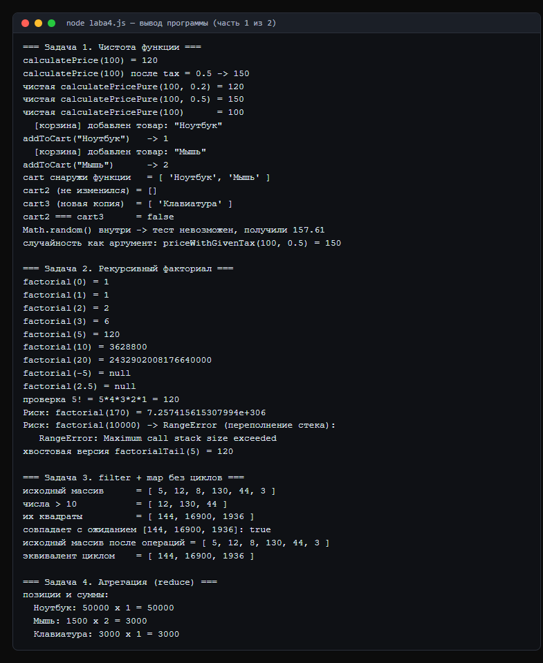

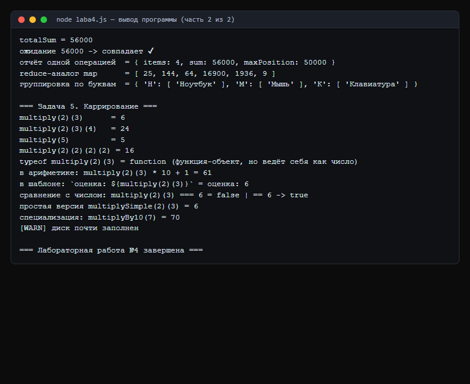

### Ответы на контрольные вопросы

**Вопрос 1. Какие функции называются «чистыми»? В чём их преимущества?**

Чистая функция детерминирована (при одинаковых аргументах всегда один результат) и не имеет побочных эффектов: не меняет внешние переменные и переданные объекты, не пишет в консоль, не обращается к сети, не использует Math.random()/Date.now() внутри. В задаче 1 функция calculatePrice НЕ чистая: она читает внешнюю переменную tax, поэтому при том же аргументе выдаёт разные значения (120 и 150). Преимущества чистых функций: простое тестирование, предсказуемость, отсутствие гонок при параллелизме, возможность кеширования и безопасного рефакторинга.

**Вопрос 2. Чем map отличается от forEach?**

map возвращает НОВЫЙ массив той же длины, преобразуя каждый элемент, и поддерживает цепочки (map → filter → reduce). forEach ничего не возвращает (undefined) и нужен для побочных эффектов — вывода, отправки, изменения внешнего состояния. Исходный массив не меняется в обоих случаях. Частая ошибка: const x = arr.forEach(...) — x всегда undefined.

**Вопрос 3. Что такое рекурсия? Назовите риски использования рекурсии.**

Рекурсия — приём, когда функция вызывает саму себя, сводя задачу к задаче меньшего размера; обязательны база (условие выхода) и шаг, приближающий к базе. Риски: переполнение стека (RangeError: Maximum call stack size exceeded — в Node предел около 10–15 тысяч вызовов, factorial(10000) падает), бесконечная рекурсия при отсутствии или недостижимости базы, повышенный расход памяти и времени по сравнению с циклом, сложность отладки. В Node.js хвостовая оптимизация не включена, поэтому рассчитывать на неё нельзя.

**Вопрос 4. Как работает reduce? Что он возвращает?**

reduce сворачивает массив в одно значение: arr.reduce((аккумулятор, элемент) => новоеЗначениеАккумулятора, начальноеЗначение). Для каждого элемента вызывается колбэк, его результат становится новым аккумулятором; reduce возвращает значение последнего вызова. Тип результата любой: число (в задаче 4 — 56000), строка, объект-отчёт, массив. Если начальное значение не указано, первым аккумулятором становится arr[0] (для пустого массива это TypeError).

---

## Лабораторная работа №5. Объекты, функция-конструктор, прототипы и наследование

### Задание

- Задание 1. Объект Book через литерал (title, author, year, pages) + метод getInfo(); динамически добавить и удалить свойство; проверить наличие через in и hasOwnProperty().
- Задание 2. Функция-конструктор Student(name, group, grades); методы getAverage() и isPassed() через prototype; показать, что методы не дублируются в объектах.
- Задание 3. Конструкторы Animal(name, sound) и Dog(name) с наследованием через Object.create(); переопределить speak(); проверить цепочку через instanceof и Object.getPrototypeOf().

### Ключевой код решения

```js
// Задание 1: объект-литерал
const book = {
    title: 'JavaScript: The Good Parts',
    author: 'Douglas Crockford',
    year: 2008,
    pages: 176,
    getInfo() { return `«${this.title}» — ${this.author}, ${this.year} г.`; }
};
book.language = 'English';          // добавили свойство динамически
delete book.language;               // удалили
'title' in book;                    // true  (ищет и в цепочке прототипов)
book.hasOwnProperty('toString');    // false — унаследовано от Object.prototype

// Задание 2: конструктор + методы на прототипе
function Student(name, group, grades) {
    this.name = name; this.group = group; this.grades = [...grades];
}
Student.prototype.getAverage = function () {
    return Math.round(this.grades.reduce((a, g) => a + g, 0) / this.grades.length * 100) / 100;
};
Student.prototype.isPassed = function () { return this.getAverage() >= 60; };

const s1 = new Student('Макар', 'ПИ-21', [85, 90, 78]);
s1.hasOwnProperty('getAverage');    // false — метод живёт на прототипе
// все экземпляры используют ОДНУ функцию: s1.getAverage === s2.getAverage

// Задание 3: наследование
function Animal(name, sound) { this.name = name; this.sound = sound; }
Animal.prototype.speak = function () { return `${this.name}: ${this.sound}`; };

function Dog(name) {
    Animal.call(this, name, 'Гав');            // вызываем родительский конструктор
}
Dog.prototype = Object.create(Animal.prototype); // наследуем прототип
Dog.prototype.constructor = Dog;                 // восстанавливаем constructor
Dog.prototype.speak = function () {              // переопределяем
    return Animal.prototype.speak.call(this) + ' — громко ГАВ!';
};
```

### Результат выполнения

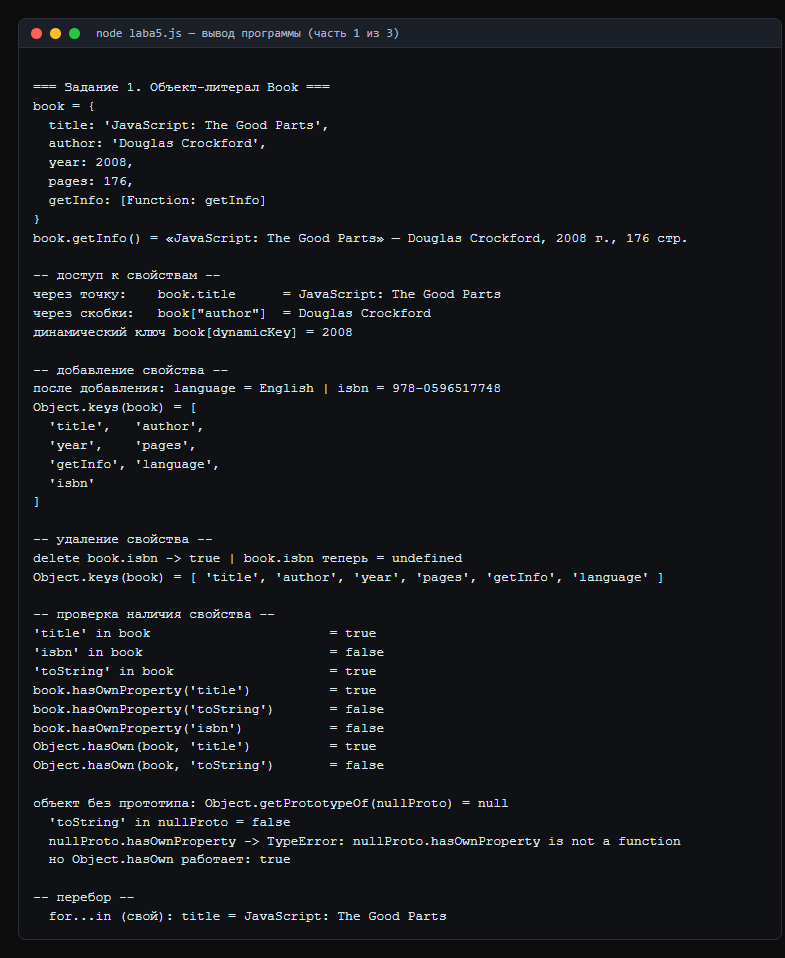

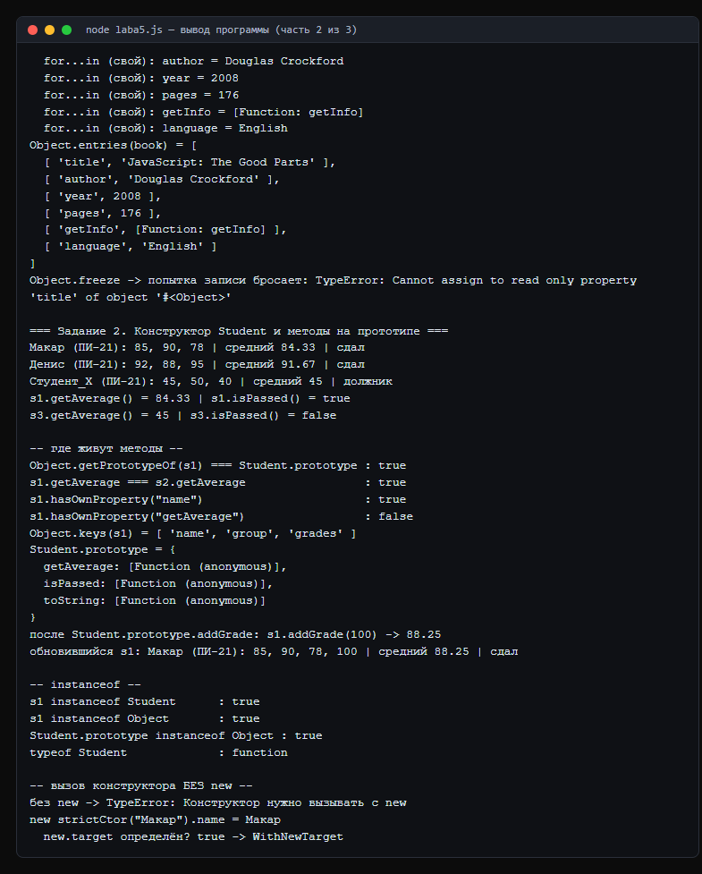

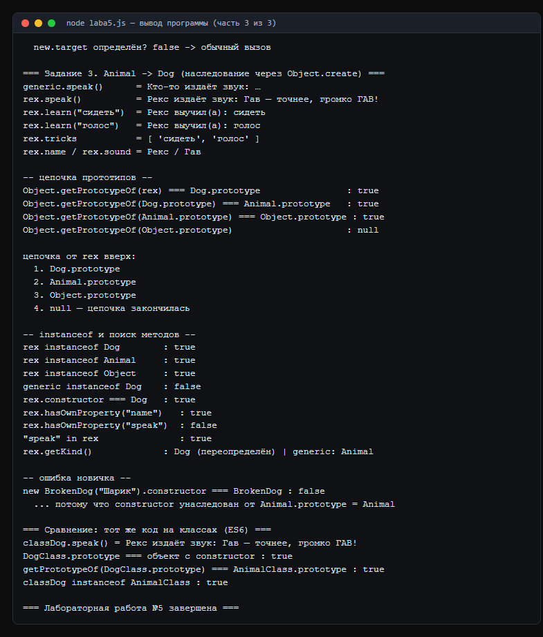

### Ответы на контрольные вопросы

**Вопрос 1. Чем отличается оператор in от hasOwnProperty()?**

Оператор in ищет свойство во всей цепочке прототипов, а hasOwnProperty() — только среди собственных свойств объекта. Пример: "toString" in book → true (унаследовано от Object.prototype), а book.hasOwnProperty("toString") → false. Сегодня удобнее использовать статический метод Object.hasOwn(obj, key): он работает и для объектов, созданных через Object.create(null), у которых метода hasOwnProperty вообще нет.

**Вопрос 2. Почему методы выгодно размещать на prototype?**

Функция создаётся один раз и используется всеми экземплярами: экономится память и появляется единая точка изменения. Если писать this.method = function () {} в конструкторе, каждый объект получит собственную копию функции. Доказательство: s1.getAverage === s2.getAverage → true, а метод, добавленный позже в Student.prototype, сразу появляется у всех уже созданных объектов.

**Вопрос 3. Зачем Object.create(Parent.prototype) и восстановление constructor?**

Object.create(Parent.prototype) создаёт НОВЫЙ объект-прототип, чей [[Prototype]] указывает на прототип родителя, и не копирует свойства родителя. Присваивать Child.prototype = Parent.prototype нельзя — тогда методы наследника «загрязнят» родителя. После замены прототипа свойство constructor теряется (начинает работать унаследованный от родителя), поэтому его восстанавливают: Child.prototype.constructor = Child, иначе obj.constructor перестанет указывать на свой конструктор.

---

## Лабораторная работа №6. Классы и наследование, исключения, короткое вычисление логических операторов

### Задание

- Задание 1. Класс BankAccount с приватным полем #balance, геттером balance, методами deposit/withdraw, статическим count и статическим compare(); класс SavingsAccount extends BankAccount с геттером и сеттером rate, методом addInterest() и переопределённым withdraw() с лимитом.
- Задание 2. Иерархия ошибок BankError → InsufficientFundsError, InvalidAmountError; функция transfer() с try/catch/finally и разбором типов через instanceof; функция loadAccount(json) с ошибкой-причиной Error.cause.
- Задание 3а. Предсказать вывод программы с && и ||, затем объяснить расхождения. Задание 3б. Привести свои примеры неочевидного поведения.

### Ключевой код решения

```js
class BankAccount {
    static count = 0;              // статическое поле: общее для всех
    #balance = 0;                  // приватное поле: недоступно снаружи

    constructor(owner, initialBalance = 0) {
        this.owner = owner;
        this.#balance = initialBalance;
        BankAccount.count += 1;
    }
    get balance() { return this.#balance; }        // геттер без сеттера — только чтение

    deposit(amount) {
        if (typeof amount !== 'number' || amount <= 0) {
            throw new InvalidAmountError(amount, 'Сумма должна быть положительной');
        }
        this.#balance += amount;
    }
    withdraw(amount) {
        if (amount > this.#balance) throw new InsufficientFundsError(amount, this.#balance);
        this.#balance -= amount;
    }
    static compare(a, b) { return a.balance - b.balance; }
}

class SavingsAccount extends BankAccount {
    #rate = 5;
    constructor(owner, balance, rate, limit) {
        super(owner, balance);     // обязательно до обращения к this
        this.rate = rate;          // сработает сеттер с проверкой диапазона
        this.withdrawalLimit = limit;
    }
    get rate() { return this.#rate; }
    set rate(value) {
        if (value < 0 || value > 100) throw new RangeError('Ставка должна быть 0..100');
        this.#rate = value;
    }
    addInterest() { return this.deposit(this.balance * this.#rate / 100); }
    withdraw(amount) {
        if (amount > this.withdrawalLimit) throw new BankError('Превышен лимит снятия');
        return super.withdraw(amount);       // вызов родительской версии метода
    }
}

class BankError extends Error {
    constructor(message, options) { super(message, options); this.name = 'BankError'; }
}
class InsufficientFundsError extends BankError {
    constructor(requested, available) {
        super(`Недостаточно средств: запрошено ${requested} ₽, доступно ${available} ₽`);
        this.name = 'InsufficientFundsError';
        this.requested = requested; this.available = available;
    }
}
```

### Результат выполнения

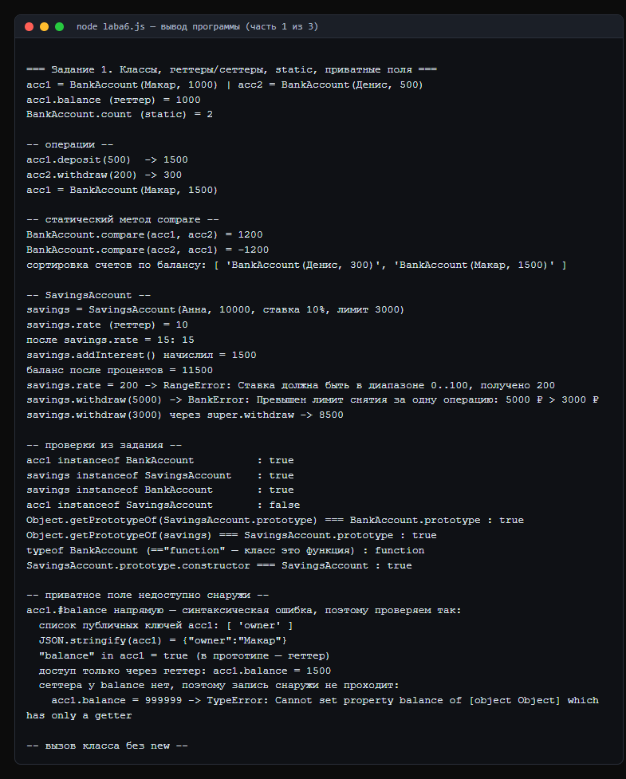

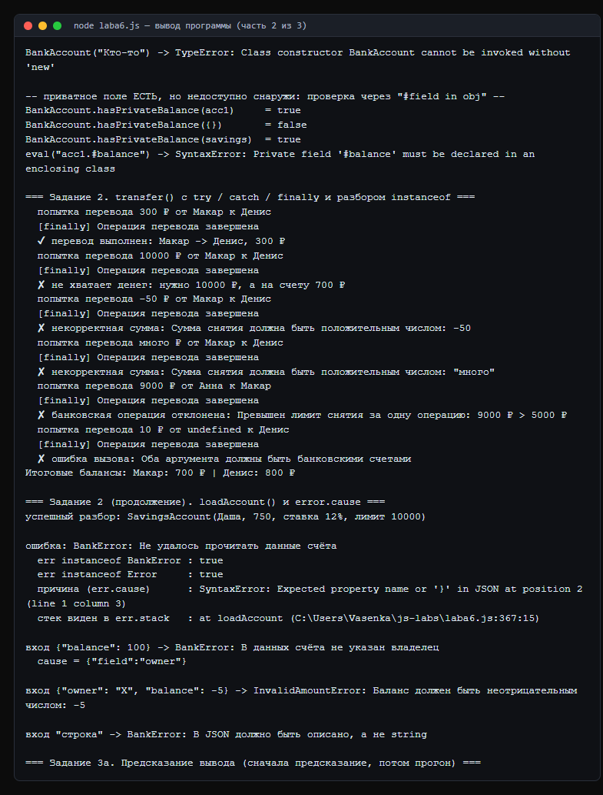

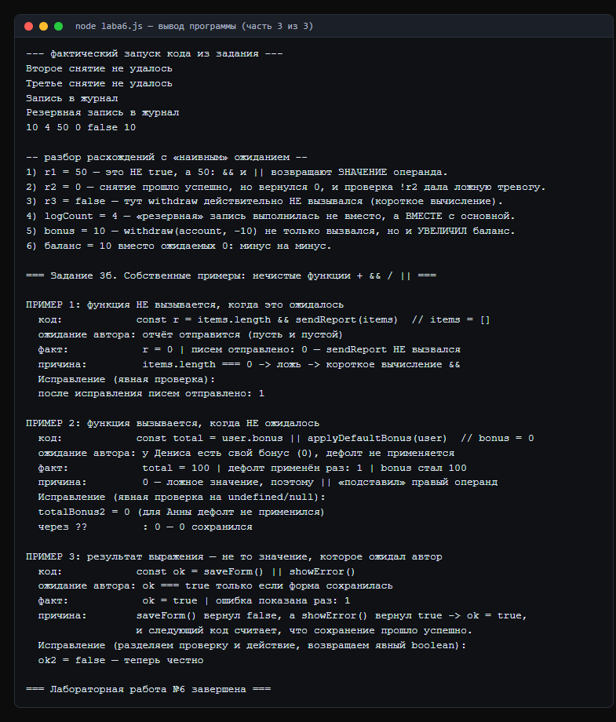

### Ответы на контрольные вопросы

**Вопрос 1. Задание 3а. Что выводится в консоль и чему равны account.balance, logCount, r1, r2, r3, bonus?**

Вывод: «Второе снятие не удалось», «Третье снятие не удалось», «Запись в журнал», «Резервная запись в журнал», затем строка «10 4 50 0 false 10». Значения: account.balance = 10, logCount = 4, r1 = 50, r2 = 0, r3 = false, bonus = 10. Разбор: && и || возвращают ЗНАЧЕНИЕ операнда, а не true/false, поэтому r1 равно 50 (результат withdraw). Второе снятие прошло успешно, но вернуло 0 — ложное значение, и условие !r2 выдало ложную тревогу. В третьем случае баланс 0, поэтому сработало короткое вычисление и withdraw не вызывался. Конструкция log(...) || log(...) напечатала ОБА сообщения, так как log возвращает undefined. Наконец, bonus = account.balance || withdraw(account, -10): баланс 0 — ложь, поэтому вызвался withdraw с отрицательной суммой и баланс УВЕЛИЧИЛСЯ до 10 (минус на минус).

**Вопрос 2. Задание 3б. Свои примеры неочевидного поведения && и || с нечистыми функциями.**

Пример 1 (функция не вызывается, когда ожидалось): const r = items.length && sendReport(items) — при пустом массиве length === 0 (ложь), поэтому sendReport не выполнится вообще. Исправление: проверять условие явно через if (items.length >= 0) либо вызывать функцию без &&. Пример 2 (функция вызывается, когда не ожидалось): const total = user.bonus || applyDefaultBonus(user) — если bonus равен 0 (легитимное значение), правый операнд выполнится и перезапишет бонус на 100. Исправление: проверять на undefined/null (user.bonus !== undefined) или использовать оператор ??. Пример 3 (результат не тот, что ожидался): const ok = saveForm() || showError() — saveForm вернул false, showError вернул true, и ok === true, поэтому вызывающий код считает сохранение успешным. Исправление: разделить проверку и действие (if/else) и возвращать явный boolean.

**Вопрос 3. Чем класс отличается от функции-конструктора?**

Класс — синтаксическая надстройка над прототипами: методы так же лежат на prototype, но код короче и безопаснее. Класс нельзя вызвать без new (TypeError сразу), тело класса всегда выполняется в строгом режиме, методы не перечисляются в for...in, есть приватные поля (#balance), вызов родителя через super() и автоматическое восстановление constructor у наследника. По сравнению с решением из лабораторной работы №5, где прототипы настраивались вручную (Animal.call, Object.create, восстановление constructor), код на классах примерно вдвое короче и понятнее.

---

## Лабораторная работа №7. Node.js: события (EventEmitter) и потоки (streams)

### Задание

- Задание 1. Класс Counter extends EventEmitter: increment() увеличивает value и генерирует «change», при достижении максимума — «limit», дальше — «error». Проверить поведение без обработчика ошибки.
- Задание 2. Прочитать текстовый файл через fs.createReadStream с highWaterMark: 16, вывести номер и содержимое каждого куска, по событию end — количество кусков и символов; обработать error на несуществующем файле; скопировать файл через pipe() и сверить содержимое.
- Задание 3. Transform-поток: перевод в верхний регистр и подсчёт символов; pipeline файл → Transform → result.txt; обработка ошибки; дополнительно — вывод в process.stdout вместо файла.

### Ключевой код решения

```js
class Counter extends EventEmitter {
    constructor(max = 3) { super(); this.value = 0; this.max = max; this.limitReached = false; }

    increment() {
        if (this.limitReached) {
            this.emit('error', new RangeError('Лимит достигнут'));   // без обработчика уронит процесс
            return this.value;
        }
        this.value += 1;
        this.emit('change', this.value);
        if (this.value >= this.max) { this.limitReached = true; this.emit('limit', this.max); }
        return this.value;
    }
}
counter.on('change', (v) => console.log('новое значение:', v));
counter.once('limit', (max) => console.log('достигнут максимум:', max));
counter.on('error', (err) => console.log('ошибка:', err.message));

// Задание 2: чтение потока кусками по 16 байт
const stream = fs.createReadStream(INPUT_FILE, { encoding: 'utf8', highWaterMark: 16 });
stream.on('data', (chunk) => console.log('кусок:', JSON.stringify(chunk)));
stream.on('end', () => console.log('файл прочитан'));
stream.on('error', (err) => console.error('ошибка:', err.message));

fs.createReadStream(INPUT_FILE).pipe(fs.createWriteStream(COPY_FILE));   // копирование

// Задание 3: свой Transform + pipeline
const upperCounter = new Transform({
    transform(chunk, _enc, callback) {
        const text = decoder.write(chunk);      // StringDecoder не рвёт многобайтовые символы
        processedChars += text.length;
        callback(null, text.toUpperCase());
    }
});
await pipeline(
    fs.createReadStream(INPUT_FILE, { highWaterMark: 16 }),
    upperCounter,
    fs.createWriteStream(RESULT_FILE)
);
```

### Результат выполнения

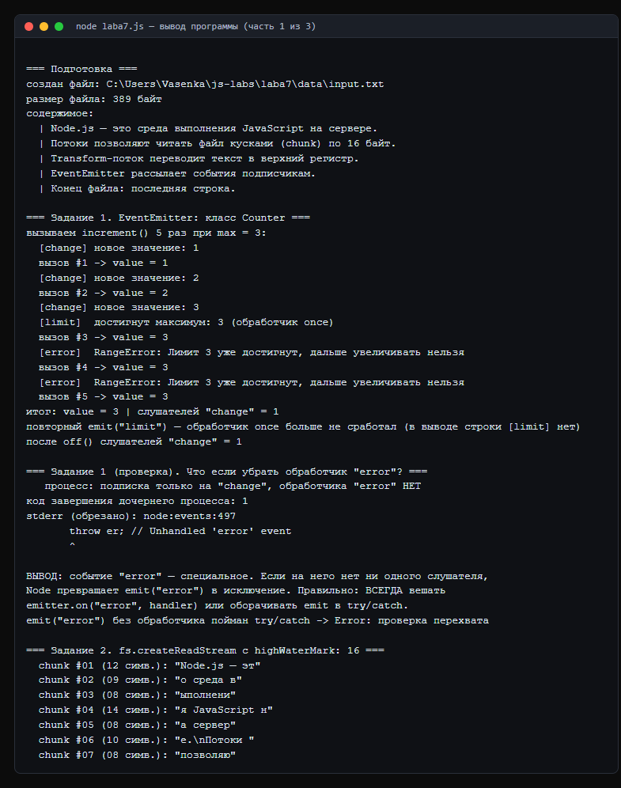

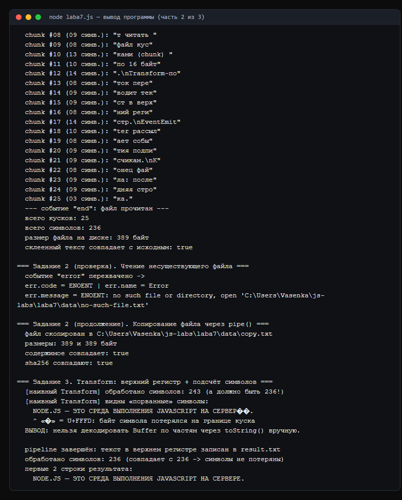

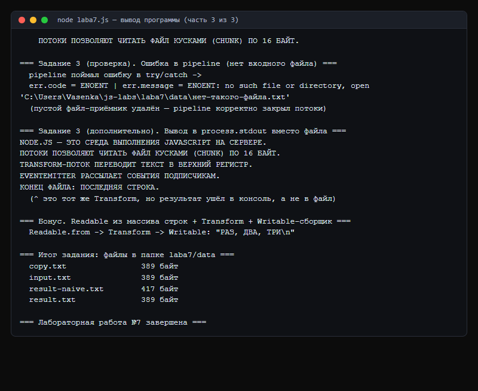

### Ответы на контрольные вопросы

**Вопрос 1. Что произойдёт, если убрать обработчик события «error»?**

Событие error в Node.js особенное: если у него нет ни одного слушателя, emit('error') превращается в исключение и роняет процесс с ошибкой ERR_UNHANDLED_ERROR (ExitCode 1). Проверено в отдельном дочернем процессе: код завершения 1, в stderr — «Unhandled 'error' event». Поэтому на каждый EventEmitter либо вешают обработчик через .on('error', handler), либо оборачивают emit в try/catch.

**Вопрос 2. Чем события end и finish отличаются? Что такое highWaterMark?**

end — событие Readable: читать больше нечего. finish — событие Writable: все данные записаны и сброшены. Это разные потоки и разные моменты времени. highWaterMark — размер одной порции данных (для файлов по умолчанию 64 КБ); он измеряется в БАЙТАХ, поэтому при значении 16 куски будут по 16 байт, а буква кириллицы занимает 2 байта — границы кусков попадают внутрь символа.

**Вопрос 3. Почему в задании 3 нужен StringDecoder и чем pipeline лучше pipe?**

При чтении без encoding в обработчик приходят Buffer-ы, нарезанные по 16 байт. Если вызывать chunk.toString() на куске, разрезанном посередине многобайтового символа, последний байт превратится в символ замены «�» и текст испортится (в отчёте это видно: наивный вариант обработал 243 символа вместо 236 и выдал «СЕРВЕР��»). StringDecoder хранит неполную последовательность до следующего куска и возвращает только целые символы — при этом счётчик совпадает с ожидаемым (236). pipeline предпочтительнее pipe, потому что при ошибке в любом звене он уничтожает все потоки и пробрасывает ошибку в try/catch, тогда как pipe оставляет открытые дескрипторы и «зависшие» записи.

---

## Лабораторная работа №8. React-компонент, AJAX, Comet, WebSocket

### Задание

- Задание 1. React-компонент ProgressBar: полоса растёт на 1% каждые `speed` миллисекунд, по достижении 100% появляется надпись «Готово!» и кнопка «Заново»; разместить два ProgressBar с разной скоростью.
- Задание 2. AJAX: страница с полем ввода, кнопкой и списком сообщений; отправка через fetch; обновление списка раз в 2 секунды через setInterval; проверка в двух вкладках.
- Задание 3. Comet (long polling) через маршрут GET /api/poll и та же страница на WebSocket.

### Ключевой код решения

```jsx
// laba8/progress-app/src/components/ProgressBar.jsx
export default function ProgressBar({ speed = 100, title = 'Прогресс', color = '#2f6feb' }) {
    const [value, setValue] = useState(0);
    const isDone = value >= 100;

    useEffect(() => {
        if (isDone) return undefined;

        const id = setInterval(() => {
            setValue(prev => (prev + 1 >= 100 ? 100 : prev + 1));
        }, speed);

        return () => clearInterval(id);   // очистка обязательна: иначе таймеры «утекают»
    }, [speed, isDone]);

    const restart = () => setValue(0);

    return (
        <section>
            <div className="progress-track" role="progressbar" aria-valuenow={value}>
                <div className="progress-fill" style={{ width: `${value}%`, background: color }} />
            </div>
            <span>{value}%</span>
            {isDone && <><strong>Готово!</strong><button onClick={restart}>Заново</button></>}
        </section>
    );
}
```

```js
// laba8.js — сервер: long polling (Comet). Сервер молчит, пока нет нового сообщения
if (req.method === 'GET' && pathname === '/api/poll') {
    const lastId = Number(query.lastId || 0);
    const missed = messages.filter((m) => m.id > lastId);
    if (missed.length > 0) return sendJson(res, 200, { type: 'messages', messages: missed });

    waitingClients.push(res);                       // «подвешиваем» ответ
    setTimeout(() => { /* таймаут 25 с, ответ "нет новостей" */ }, 25_000);
    return true;
}

// при добавлении сообщения все ожидающие получают ответ сразу
function addMessage(message) {
    messages.push(message);
    while (waitingClients.length > 0) {
        sendJson(waitingClients.shift(), 200, { type: 'message', message });
    }
    for (const client of sseClients) client.write(`data: ${JSON.stringify(message)}\n\n`);
    if (wss) for (const socket of wss.clients) socket.send(JSON.stringify({ type: 'message', message }));
}
```

### Результат выполнения

Сервер проверен встроенной самопроверкой `node laba8.js --selftest`: все транспорты отвечают корректно.

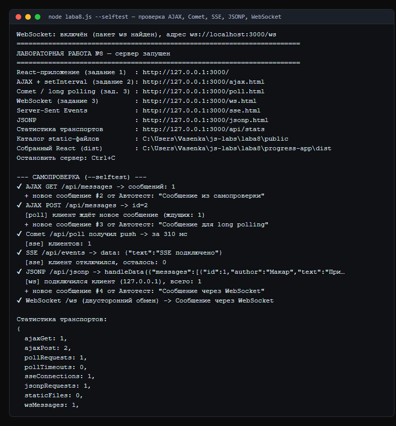

Страницы заданий 1–3 запускаются командой `node laba8.js` и открываются в браузере:

| Задание | Адрес |
|---|---|
| 1. React-компонент ProgressBar | http://localhost:3000/ |
| 2. AJAX + setInterval | http://localhost:3000/ajax.html |
| 3. Comet (long polling) | http://localhost:3000/poll.html |
| 3. WebSocket | http://localhost:3000/ws.html |

### Ответы на вопросы задания 3

**Вопрос 1. Чем отличаются периодический опрос, long polling и WebSocket и где вместо них можно использовать Server-Sent Events?**

**Периодический опрос (polling).** Клиент по таймеру (каждые 2 секунды) спрашивает сервер «есть новое?» независимо от наличия новостей. Плюс — предельная простота. Минусы — задержка до одного интервала и лишние запросы: в DevTools видно, что даже при отсутствии сообщений уходит 30 запросов в минуту с каждой вкладки.

**Long polling (Comet).** Клиент делает запрос, сервер держит его открытым и отвечает только при появлении нового сообщения (или по таймауту). Получив ответ, клиент сразу открывает следующий запрос. Плюсы — новые сообщения приходят мгновенно, «пустых» запросов нет, работает через обычный HTTP. Минусы — на сервере висит по одному открытому соединению на клиента; есть «зазор» между ответом и новым запросом, куда может попасть сообщение; при реконнекте легко потерять события (в работе это решается параметром lastId).

**WebSocket.** Один раз выполняется HTTP-рукопожатие с заголовком Upgrade: websocket, после чего соединение остаётся открытым и данные идут в обе стороны кадрами с минимальным служебным заголовком. Плюсы — минимальная задержка и настоящий двусторонний канал. Минусы — нужен пакет ws или другой сервер; самим приходится реализовывать переподключение, ping/pong, авторизацию; часть прокси и корпоративных сетей блокирует ws://.

**Server-Sent Events.** Односторонний канал от сервера к клиенту поверх обычного HTTP (Content-Type: text/event-stream). Использовать вместо опроса и long polling можно, когда данные идут только от сервера: лента новостей, тикеры и курсы, прогресс длительной операции, уведомления, мониторинг. Дополнительные плюсы — нативный EventSource, автоматическое переподключение, совместимость с HTTP/2 и корпоративными прокси. Не подходит, когда нужен двусторонний обмен с низкой задержкой (чаты, игры, совместное редактирование) — там WebSocket, а также для бинарных данных: SSE передаёт только текст.

### Результаты сравнения в DevTools

| Транспорт | Что видно в Network | Запросов при простое |
|---|---|---|
| AJAX + setInterval | каждые 2 секунды уходит GET /api/messages | около 30 в минуту |
| Long polling | один запрос GET /api/poll висит в состоянии pending | 1 (висит) |
| WebSocket | один запрос 101 Switching Protocols, дальше — кадры | 0 |

---

## Итог

Все 8 лабораторных работ выполнены полностью и проверены запуском: вывод каждой программы приведён выше в виде скриншотов. Дополнительно реализован учебный проект — сайт фотостудии (React + Node.js + Express + EJS) с галереей, новостями, формой обратной связи, админкой под паролем и интеграциями со сторонними сервисами; материалы проекта и доклады приложены отдельными файлами.
